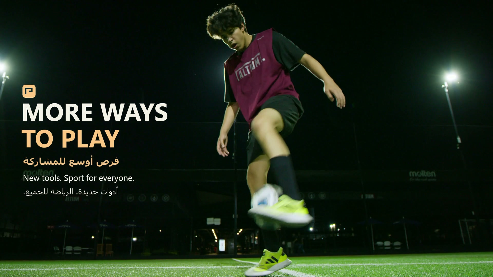
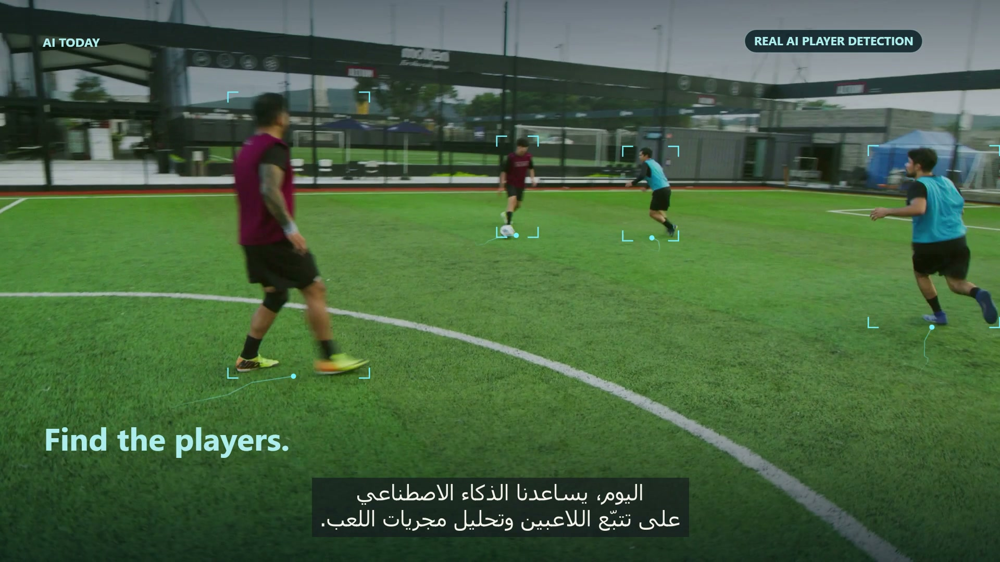
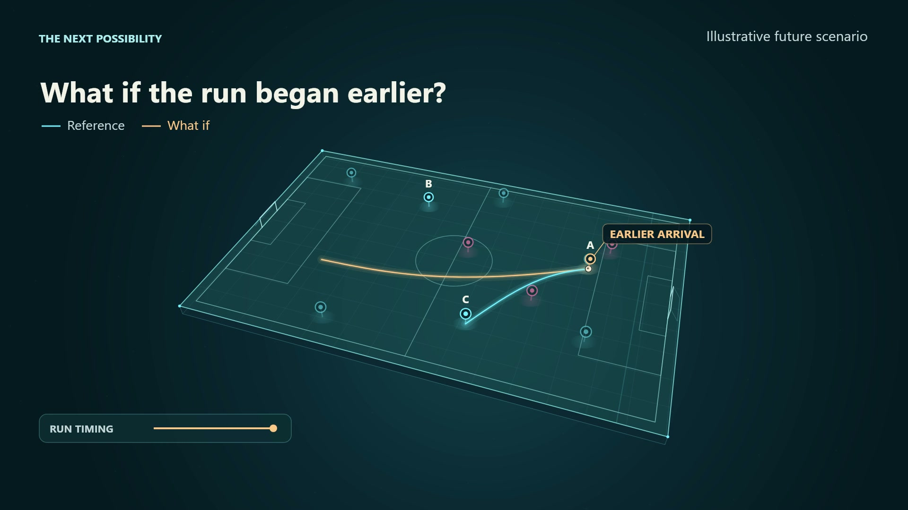
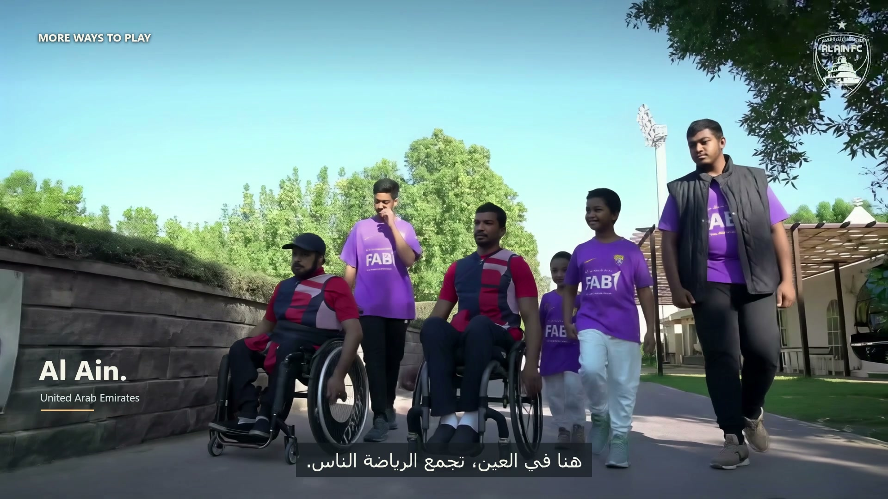
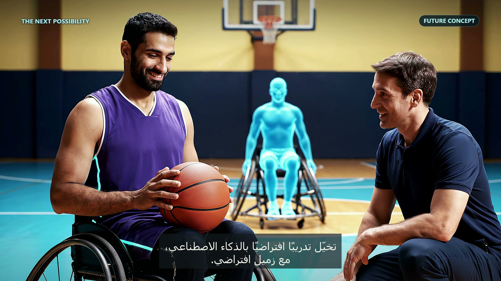

# More Ways to Play

**First Place · Student AI Challenge · ICAIS 2026**

A first-place film in the ICAIS 2026 Student AI Challenge, screened during the conference's opening ceremony.

**More Ways to Play** combines computer vision, original tactical visualizations and storytelling to explore how AI could support coaching and make sport more accessible, including for People of Determination.

[](https://drive.google.com/file/d/1Dan57P498kJB_SiNYuy8Uqsq48UVTwYS/view)

**[Watch the final film](https://drive.google.com/file/d/1Dan57P498kJB_SiNYuy8Uqsq48UVTwYS/view)** · [Award and conference](docs/RECOGNITION.md) · [Production](docs/PRODUCTION.md) · [Credits](CREDITS.md)

Created by **Taysir Eyad Al Daqrouq**, United Arab Emirates University, College of Computing and Artificial Intelligence.

## The idea

Before a goal, there is an idea: a remembered run, a line in a notebook, a match worth watching again. The film follows that thread from football's history to computer vision and imagined tactical exploration, then asks a broader question: **who gets to take part?**

The story moves to Al Ain and wheelchair basketball, imagining a practice environment that adapts to the athlete. A virtual teammate brings the pass closer or allows more time. The athlete and coach choose the challenge together.

The closing returns to people playing sport. Technology supports their choices; participation is the point.

## Recognition

The entry won **First Place in the Student AI Challenge** at the **International Conference on Artificial Intelligence in Sports (ICAIS 2026)**, held in Al Ain on **12–13 October 2026**. The film was screened during the conference opening ceremony.

ICAIS was hosted by UAEU, with Al Ain Sports and Cultural Club as strategic sports partner. [See the certificate and conference links](docs/RECOGNITION.md).

## What is in the film?

| Chapter | Treatment | Purpose |
| --- | --- | --- |
| Football, memory and replay | Archival and contemporary footage | Establish why people study movement |
| Following the players | Actual anonymous person detection | Introduce a concrete computer-vision application |
| Earlier run, wider pass | Original animated pitch and authored alternatives | Make a coaching question visible |
| Al Ain and participation | Documentary wheelchair-basketball and community footage | Connect the idea to people and place |
| Adaptive practice | Fictional future-training cinematics | Imagine how coaching could adapt to an athlete |
| More ways to play | Human-centred closing and conference identity | Bring the story back to participation |

This is a **film and production showcase**, not a released coaching application. The tactical alternatives are authored illustrations, not AI predictions. The future-training scenes illustrate a possibility, not an installed or clinically evaluated system.

## Scenes from the film

Every image below is a frame taken directly from the final film, with its original composition, graphics and subtitles.

| Following the players | Exploring an earlier run |
| --- | --- |
|  |  |
| **0:27.50** — Computer vision follows the players. | **0:47.00** — An authored alternative makes the coaching question visible. |

| Here in Al Ain | Adaptive practice |
| --- | --- |
|  |  |
| **1:02.00** — The story connects sport, people and place. | **1:17.00** — A future-training cinematic imagines practice adapting to the athlete. |

The cover is the film's closing title over the juggling footage at **1:42.00**. Image sources remain credited in [CREDITS.md](CREDITS.md).

## Original graphics component

The repository also includes a portable adaptation of the programmed tactical graphics. It can render illustrative frames without any footage or narration. The README images above come from the completed film, rather than this adaptation.

### Run the renderer

Requires **Node.js 20 or later**.

```sh
npm install
npm run render
```

Three 1920 × 1080 PNGs are written to `renders/`. To render a short image sequence:

```sh
npm run render:sequence
```

The component uses its own internal timeline, not the final film's timestamps. See [production notes](docs/PRODUCTION.md) for the scope and options. It does not reproduce the full film or run person detection.

## Film and accessibility

- **1:58.08**, 1920 × 1080, 24 fps; H.264 MP4 with AAC audio.
- English narration with burned-in Arabic subtitles.
- [English transcript](transcript.md), [English SRT](subtitles/en.srt), and [Arabic SRT](subtitles/ar.srt).
- The full-quality film is hosted externally to keep this repository small.

## Production approach

The film combines research, writing, bilingual review, programmed graphics, computer vision, documentary editing, sound design and selected generated cinematics. AI tools assisted production under my creative direction. [Production notes](docs/PRODUCTION.md) distinguish the real detection demonstration, authored graphics, fictional future scenes, and source footage.

Thank you to **Prof. Fady Alnajjar** and **Mr. Basheir Al-Rei** for their feedback and support throughout the revisions.

## Credits and reuse

Music: **“A Kind Of Hope” by Scott Buckley**, released under [CC BY 4.0](https://creativecommons.org/licenses/by/4.0/). [Track and creator](https://www.scottbuckley.com.au/library/a-kind-of-hope/). The music was excerpted, rearranged, mixed and faded for the film.

See [full credits](CREDITS.md) and [rights and reuse](RIGHTS.md). No blanket open-source licence is granted for the film, repository or third-party materials. Raw footage, music, narration, production credentials and the video master are not distributed here.
