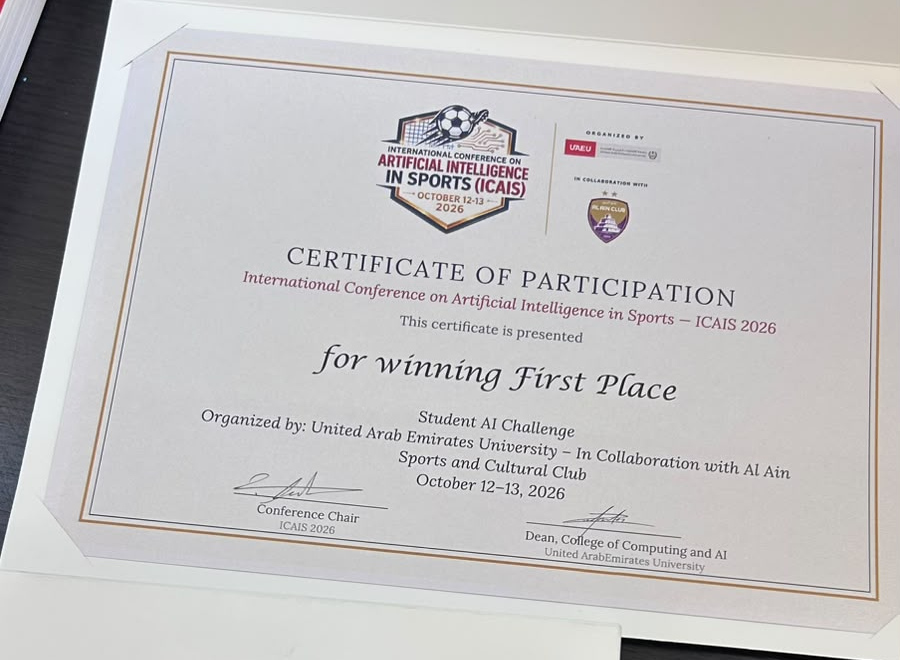

# Recognition

## First Place — Student AI Challenge

**More Ways to Play** won First Place in the Student AI Challenge at the **International Conference on Artificial Intelligence in Sports (ICAIS 2026)**. The film was also screened at the conference opening ceremony.

## Conference context

- **Dates:** 12–13 October 2026.
- **Location:** Al Ain, United Arab Emirates.
- **Host:** United Arab Emirates University.
- **Strategic sports partner:** Al Ain Sports and Cultural Club.

[Official conference website](https://conferences.uaeu.ac.ae/icais2026/en/) · [Conference overview](https://conferences.uaeu.ac.ae/icais2026/en/about.shtml)
